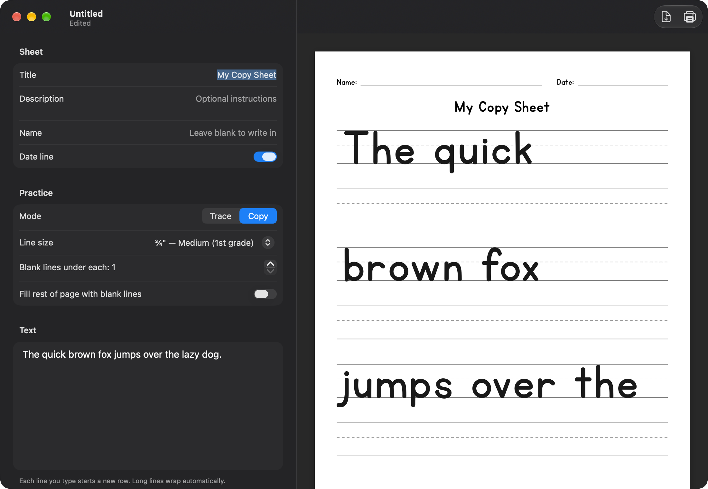
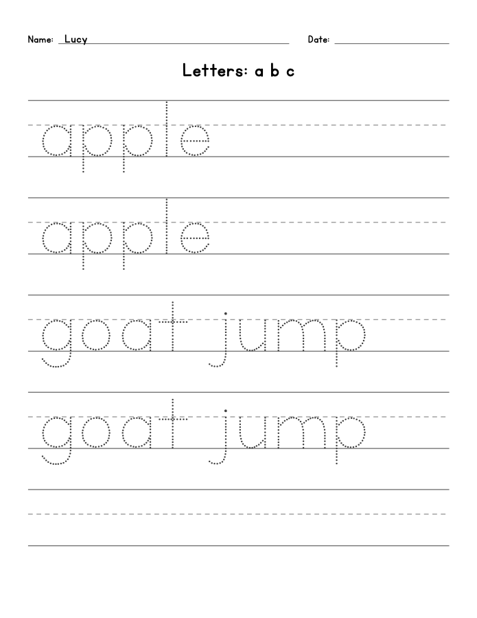
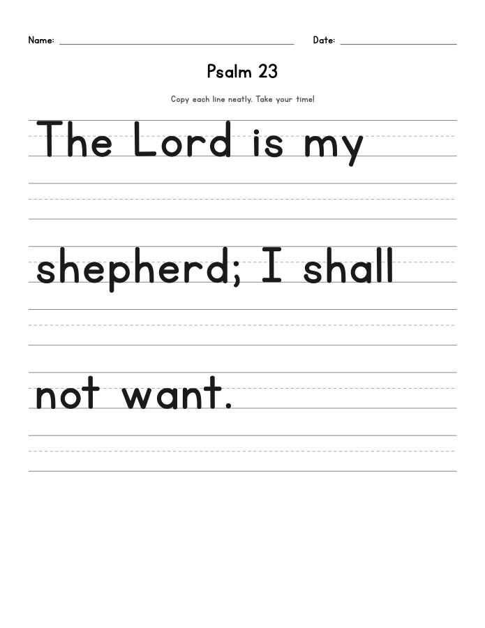

# Copy Sheets

A simple Mac app for making handwriting practice sheets — built for homeschool families.

Type a title, some instructions, and the text you want your child to practice. Pick **Trace** (dotted letters to write over) or **Copy** (a model line with blank lines underneath), choose a line size, then print or save a PDF on standard 8.5 × 11 paper.



| Trace | Copy |
|---|---|
|  |  |

## Features

- **Title, description, and name/date line** at the top of the page. Leave the name blank for your child to write it, or type it in to print it. The date line can be turned off.
- **Trace mode** — dotted, ball-and-stick print letters (single-story *a* and *g*). Choose how many times each line repeats.
- **Copy mode** — a solid model line with 1–6 blank handwriting lines under it.
- **Line sizes from 1½" to ⅜"** — jumbo lines for preschoolers down to small lines for older kids.
- Classic handwriting guides: solid top line, dashed midline, solid baseline.
- Long lines wrap automatically and flow onto extra pages.
- **Print** (⌘P) or **Export PDF** (⇧⌘E).
- Save sheets as `.copysheet` files to reuse later.

## Install

Requires **macOS 14 (Sonoma) or newer**.

1. **[Download Copy-Sheets.zip](https://github.com/martyvasquez/copy-page/releases/latest/download/Copy-Sheets.zip)** (or grab it from the [Releases](https://github.com/martyvasquez/copy-page/releases) page).
2. Double-click the zip to unzip it.
3. Drag **Copy Sheets** into your **Applications** folder.
4. Open it. The first time, macOS will say it can't verify the developer (this is a free, home-built app, not from the App Store). Click **Done**.
5. Open **System Settings → Privacy & Security**, scroll down, and click **Open Anyway** next to *"Copy Sheets" was blocked*. Enter your password.

That's it — from then on it opens normally. To keep it handy, right-click its Dock icon and choose **Options → Keep in Dock**.

## Using it

1. Fill in the **Title** and (optionally) a **Description** with instructions, a **Name**, and whether to include the **Date line**.
2. Pick **Trace** or **Copy** and a **Line size**.
3. Type the practice text. Each line you type starts a new row; long lines wrap on their own.
4. Watch the preview on the right, then click **Print** or **Export PDF** in the toolbar.

Tip: turn on **Fill rest of page with blank lines** for extra practice space.

## Build from source

You'll need Xcode 16 or newer.

```sh
git clone https://github.com/martyvasquez/copy-page.git
cd copy-page
open CopySheet.xcodeproj
```

Then press **⌘R** to run. The Xcode project is generated from `project.yml` with [XcodeGen](https://github.com/yonaskolb/XcodeGen) — if you add or remove files, run `xcodegen generate`.

To build a release copy from the command line:

```sh
xcodebuild -project CopySheet.xcodeproj -scheme CopySheet -configuration Release -derivedDataPath build/DerivedData build
# App: build/DerivedData/Build/Products/Release/Copy Sheets.app
```

### Project layout

| Path | What it is |
|---|---|
| `CopySheet/CopySheet.swift` | The sheet model (everything saved in a `.copysheet` file) and line-size presets |
| `CopySheet/CopySheetDocument.swift` | Document type — sheets are saved as JSON |
| `CopySheet/SheetRenderer.swift` | Page layout and drawing; the preview, PDF, and printout all use this |
| `CopySheet/SheetOutput.swift` | Print and Export PDF |
| `CopySheet/ContentView.swift` | Editor form and live page preview |
| `CopySheet/CopySheetApp.swift` | App entry point and File menu commands |
| `CopySheet/Fonts/` | Bundled KG fonts and their terms of use |
| `scripts/make-icon.swift` | Renders the app icon: `swift scripts/make-icon.swift CopySheet/Fonts/KGPrimaryPenmanshipAlt.ttf icon_1024.png` |

## Fonts

Letters use **KG Primary Penmanship** and **KG Primary Dots** by [Kimberly Geswein](https://kimberlygeswein.com), which are free for personal use. See her [licensing information](https://kimberlygeswein.com/kg-font-licensing-information/) for terms. This app is a free, non-commercial tool for families.
